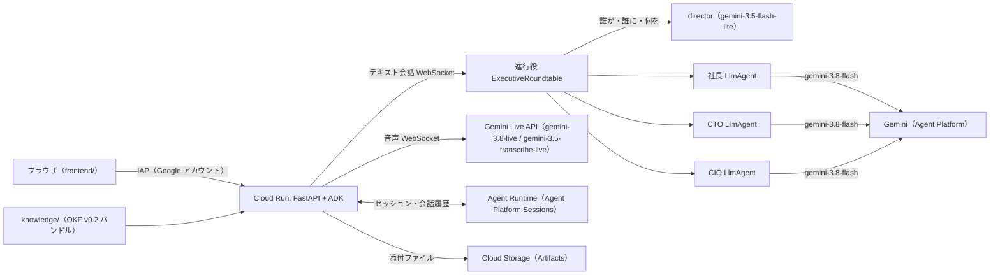

# ミナトヤ 幹部シミュレーター（社内決裁・幹部ミーティングの練習）

架空の小売・物流グループ「ミナトヤ・ホールディングス」の社長・CTO・CIO と、**1対1で相談（対話モード）**したり、**幹部会議で決裁を取ったり（ミーティングモード）**できる Web アプリです。ペルソナのデータセット（[knowledge/](knowledge/index.md)）をもとに、性格・口癖・判断の軸・論点ごとの立場を持ったエージェントが応答します。

> **すべて架空です。** 会社、人物、数値、出来事は創作で、実在の企業や人物とは関係ありません。基準日は2026年11月1日です。

## できること

| 機能 | 内容 |
|---|---|
| キャラクター選択 | 開始画面にアニメ調のアイコン（待機中は揺れ、話すと口が動く）が並ぶ。**1人を選ぶと対話モード、複数でミーティングモード** |
| ペルソナの準備 | 開始時のローディング中に、人物像（性格・口癖・判断の軸）を読み込み、テーマに合う資料を選んで読み、各役員が「事前の考え」をまとめてから始まる |
| 会話 | テキストチャット、音声（Gemini Live API）、添付ファイル（PDF・画像・テキスト）の提出 |
| 自然な会話 | 挨拶で始まり、雑談をはさむ。対話モードは交互の一問一答にせず、続けて話したり、沈黙に助け舟を出したりする。ミーティングモードは役員どうしも掛け合う |
| 時間制限 | 開始時に持ち時間を設定（既定の上限は5分）。**残り1分**で役員からまとめを促し、**10秒前**に結論が出ていなければ議長が割り込んで「承認／条件付き承認／非承認／やり直し／Goサイン」を言い渡して終わる |

## 構成



| 層 | 使っているもの |
|---|---|
| 認証 | Cloud Run の IAP 直接統合（`--iap`）。利用者は IAP のヘッダー `X-Goog-Authenticated-User-Email` で識別 |
| 基盤 | Cloud Run（WebSocket、タイムアウト3600秒） |
| セッション | Agent Runtime のセッションサービス（`agentengine://...`）。起動時に Runtime を探し、なければ作る（[services.py](app/app_utils/services.py)） |
| フレームワーク | ADK（google-adk 2.x）、agents-cli で scaffold（`--deployment-target cloud_run --session-type agent_platform_sessions`） |
| モデル | 会話: `gemini-3.8-flash`（思考 LOW）／進行役・資料選び: `gemini-3.5-flash-lite`／音声会話: `gemini-3.8-live`／会議の音声入力: `gemini-3.5-transcribe-live`。すべて環境変数で変更可 |
| データ | [knowledge/](knowledge/index.md) を Open Knowledge Format（OKF）v0.2 のバンドルとして整理。frontmatter（type・description・issues・load）で資料を選ぶ |

### 会話の進め方（[app/agent.py](app/agent.py)、[app/conversation.py](app/conversation.py)）

1. ユーザーの発言（または進行の合図）を受けると、進行役の director が `relationships.yaml` の会議の型とヒント（毎回全員に話させない、CTO と CIO の応酬は2往復まで、社長の結論は最後、など）に沿って、次に話す人・相手・ねらいを決める
2. ペルソナの LlmAgent を順に呼ぶ。システムプロンプトは「共通の資料 → 人物像（`scripts/build_prompt.py`）→ 今回の場と事前の考え → 会話のルール → いまの番のメモ」の順（共通の接頭辞を先に置き、暗黙のキャッシュを効かせる）
3. ユーザーが途中で発言したら、残りのターンを打ち切って割り込みを優先する
4. 時間の合図（残り1分・10秒前）と沈黙の合図は「【進行】」で始まるメッセージとして流し、エージェント側から話しかける

## はじめかた

前提: Python 3.12 以上、[uv](https://docs.astral.sh/uv/)、Google Cloud の ADC（`gcloud auth application-default login`）、[agents-cli](https://google.github.io/agents-cli/)。

```bash
cp .env.example .env      # GOOGLE_CLOUD_PROJECT を自分のプロジェクトにする
make install
make dev                  # http://localhost:8000 （セッションはメモリ）
make dev-agent-runtime    # セッションを Agent Runtime に保存して起動
```

### Makefile のターゲット

| ターゲット | 内容 |
|---|---|
| `make install` | 依存関係を入れる（`uv sync`） |
| `make dev` | ローカル起動（セッションはメモリ、ホットリロード） |
| `make dev-agent-runtime` | ローカル起動（セッションは Agent Runtime） |
| `make playground` | ADK のプレイグラウンド（`agents-cli playground`）。デプロイ先でも `https://<URL>/playground` で開ける（IAP で保護） |
| `make test` | データ検証（validate・OKF lint）とユニットテスト |
| `make lint` | ruff と JavaScript の構文チェック |
| `make validate` | データセットの整合性と OKF の適合性 |
| `make okf-index` | `knowledge/` の `index.md` を作り直す |
| `make wheels` | コンテナ用の依存（Linux 用 wheel）を取得する（取得元は `WHEEL_INDEX`、既定は PyPI） |
| `make build` | コンテナをビルド（Cloud Build → Artifact Registry） |
| `make setup` | 初回だけ。API 有効化、サービスアカウント、バケット、リポジトリ |
| `make deploy` | Cloud Run にデプロイし IAP を有効化（`agents-cli deploy --iap`）、IAP サービスエージェントに invoker を付与 |
| `make iap-grant MEMBER=user:alice@example.com` | IAP で利用者を許可 |
| `make url` / `make logs` | URL の表示／ログの表示 |

### 環境変数

| 変数 | 既定 | 内容 |
|---|---|---|
| `VOICE_INPUT_ENABLED` | `true` | 音声入力（Gemini Live）の on/off |
| `MAX_DURATION_MINUTES` | `5` | 設定できる持ち時間の上限（分） |
| `WRAPUP_SECONDS` / `FINAL_CALL_SECONDS` | `60` / `10` | まとめを促す時刻／結論を出す時刻（残り秒） |
| `TEXT_MODEL` | `gemini-3.8-flash` | 会話のモデル |
| `DIRECTOR_MODEL` | `gemini-3.5-flash-lite` | 進行役・資料選びのモデル |
| `PREP_MODEL` | `TEXT_MODEL` | 事前の考えをまとめるモデル |
| `PERSONA_THINKING_LEVEL` | `LOW` | 会話の思考レベル（`gemini-3.8-flash` は `MINIMAL` 非対応） |
| `LIVE_MODEL` / `LIVE_LOCATION` | `gemini-3.8-live` / `us-central1` | 音声会話のモデルとリージョン |
| `TRANSCRIBE_MODEL` | `gemini-3.5-transcribe-live` | 会議モードの音声入力 |
| `MAX_AI_TURNS_PER_ROUND` | `4` | 会議で1回の発言に続けて AI が話す最大数 |
| `USE_IN_MEMORY_SESSION` | 未設定 | `true` でセッションをメモリに置く（ローカル用） |
| `LOGS_BUCKET_NAME` | 未設定 | 添付ファイル（Artifacts）を置く GCS バケット |
| `ADK_DEV_UI` | `true` | ADK の開発用 UI（`agents-cli playground` と同じもの）を `/playground` で出す。`false` で無効 |

## ディレクトリ構成

```
.
├── app/                        ADK エージェントと Web API
│   ├── agent.py                root_agent（進行役）とペルソナの LlmAgent
│   ├── conversation.py         進行役（director）、結論（verdict）、システムプロンプトの組み立て
│   ├── preparation.py          開始時の準備（人物像・資料選び・事前の考え）
│   ├── knowledge.py            OKF バンドルの読み込み
│   ├── server.py               REST・テキスト会話の WebSocket・タイマー
│   ├── live.py                 音声会話（Gemini Live API）
│   ├── fast_api_app.py         FastAPI（agents-cli の scaffold に組み込み）
│   └── app_utils/              セッション・Artifacts・A2A（scaffold 由来）
├── frontend/                   Web UI（HTML/CSS/JS、アバター画像）
├── knowledge/                  ペルソナ・データセット（OKF v0.2 バンドル）
├── scripts/                    validate.py / build_prompt.py / okf.py
├── tests/                      unit / integration / eval
├── deployment/terraform/       scaffold 由来の Terraform（任意）
├── Makefile、Dockerfile、agents-cli-manifest.yaml
└── SPEC.md                     仕様
```

## ペルソナ・データセット（knowledge/）

- **舞台**：静岡・清水港発祥の小売・物流グループ「ミナトヤ・ホールディングス」
- **ペルソナ**：社長・CTO・CIO の3人。性格、話し方、口癖、趣味、座右の銘、講演録をそろえた
- **共通情報**：会社概要、事業計画（中計）、IR、システム所管、経営の論点

### 3人の早見表

| | 社長 CEO | CTO | CIO |
|---|---|---|---|
| 名前 | 望月 誠一郎（61） | 真壁 玲奈（44） | 片桐 慎一（57） |
| ひとことで | 物流現場叩き上げの現場主義者 | 買収で合流したロボティクスの起業家 | 銀行システム出身の「守り」のプロ |
| 判断の軸 | お客さんは何が嬉しいか／現場は回るか／10年後に誇れるか | 測れるか／小さく試せるか／後から戻せる判断か | 止まったらどうなるか／運用は誰がやるか／5年間でいくらかかるか |
| 口癖 | やらまいか／現場は見た？／それ、日本語で言うと？ | それ、どうやって測ります？／往復ドアなら、今日決めましょう | 念のため確認ですが／それ、運用は誰がやるんですか／段取り八分です |
| 話し方 | 標準語。気持ちが乗ると遠州弁が出る | 結論から入る。早口で、カタカナ語が多い | 丁寧語で論点に番号を振る。将棋の比喩を使う |
| 座右の銘 | 荷物の向こうに、人がいる（父の言葉） | 巧遅は拙速に如かず — ただし、安全は巧遅で | 米百俵 |
| 趣味 | 駿河湾の船釣り、男声合唱、家庭菜園 | トレイルラン、自作キーボード、猫（ダイクストラ） | 将棋（アマ四段）、城めぐり、落語 |
| 上期未達の見立て | 客数と売場の問題。報告が遅いことも | 発注が人の勘頼み。TIDEの遅延がボトルネック | 計画が楽観的だった。実証14本で現場の負荷が増えた |
| 弱点 | 撤退の判断が遅い。ITのリスクを「誰が言うか」で判断する | 根回しが足りない。「レガシー」発言で人を傷つける | 悪い報告を整理してから上げるので、遅れる |

3人の診断が**わざと食い違う**ように作っています。同じ数字（[facts.yaml](knowledge/company/facts.yaml) の計画差異）を見ても解釈が違うので、会議で議論が起きます。

### OKF（Open Knowledge Format）としての構成

`knowledge/` は [OKF v0.2](https://github.com/GoogleCloudPlatform/open-knowledge-format) のバンドルです。`index.md`（目次）と `log.md`（更新履歴）以外の `.md` は「コンセプト」で、先頭の frontmatter に `type`（必須）、`title`、`description`、`tags` を持ちます。このリポジトリ独自の拡張キーは次の3つです。

| キー | 内容 |
|---|---|
| `issues` | 関係する経営の論点 ID（`company/facts.yaml` の `open_issues`） |
| `personas` | 関係するペルソナ ID |
| `load` | `always`（常に読む）／`on_demand`（テーマに応じて読む）／`few_shot`（口調の手本） |

アプリは開始時に、frontmatter だけ（目次）を見てテーマに合う資料を選び（段階的開示）、選んだ資料の本文だけを読み込みます。

```
knowledge/
├── index.md / log.md                 目次（okf_version: "0.2"）と更新履歴
├── relationships.md / .yaml          呼び方、2人ずつの関係、対立軸、会議の進め方（Relationship Map）
├── company/
│   ├── facts.md / facts.yaml         ★数値・事実の正（Dataset。Single Source of Truth）
│   ├── 01_company_profile.md         会社概要（Reference）
│   ├── 02_mid_term_plan.md           中期経営計画（Plan）
│   ├── 03_ir_2026-02_results.md      通期決算（IR Document）
│   ├── 04_ir_2027-02_h1_briefing.md  中間決算と決算説明会（IR Document）
│   ├── 05_it_landscape.md            システムの所管マップ、TIDE、3.9事案（Reference）
│   ├── 06_open_issues.md             経営の論点8件（Issue Register）
│   └── 07_glossary.md                社内用語集（Glossary）
├── personas/<id>/
│   ├── persona.md                    人物カード（Persona。UI の色・声・アバターも拡張キー ui に持つ）
│   ├── profile.yaml                  人物像、話し方、口癖（頻度つき）、論点ごとの立場、発言例
│   └── speeches/*.md                 講演録（Speech）
└── scenarios/
    ├── roleplay_scenarios.md         5つの場面（Playbook）
    └── sample_meeting_2026-10-20.md  経営会議の発言録（Meeting Transcript。few-shot）
```

### エージェントへの渡し方

| 層 | 何を渡すか | どう渡すか |
|---|---|---|
| 常時 | 人物カード、話し方、口癖のルール、判断の軸、地雷、論点への立場 | システムプロンプト（`scripts/build_prompt.py`） |
| 場面ごと | 一人称と敬語（対話モードは `one_on_one`、会議は `meeting`） | `--scene` で切り替える |
| テーマに応じて | `load: on_demand` の資料と講演録 | frontmatter で選んで本文を渡す |
| 口調の手本 | `scenarios/sample_meeting_2026-10-20.md` | 会議モードで few-shot として渡す |
| 複数エージェント | `relationships.yaml` の `meeting_dynamics` | 進行役（director）のプロンプトに入れる |

```bash
uv run python scripts/build_prompt.py president --scene meeting
```

`render_catchphrase_rules()` は次の方針で実装しました。場面に合わない口癖は黙って除外する（禁止語として書くと意識させるため）、上位6個に絞る、`frequency` に加えて「直前の発言で使った口癖は使わない」「口癖なしの発言を基本にする」という強いルールを足す、`example` は渡さない（同じ文を繰り返しやすいため）。

### 整合性チェック

```bash
make validate   # = uv run python scripts/validate.py && uv run python scripts/okf.py lint
```

`validate.py` は次の項目を機械的に確かめます。データを書き換えたら実行してください。

- **算術**：セグメントの合計、計画差異の要因の合計、EPS・配当性向・ROE・PBR、店舗数の県別合計
- **利益率**：業態として自然な範囲にあるか（スーパー1.5〜4%、3PL 3〜7%）
- **人物**：年齢と生年月日が一致するか、経歴が時系列順に並んでいるか
- **講演の肩書き**：講演した日の肩書きが経歴と合っているか（例：2019年の CTO はスタートアップの CTO）
- **講演の数字**：講演が引用した数字（front matter の `cited_facts`）が `facts.yaml` と一致し、本文にも出てくるか
- **論点**：すべてのペルソナが、全論点について立場（`stances`）を持っているか
- **日付**：「2026年11月10日（火）」のように書いた曜日が正しいか
- **表記**：決算期の表記に「FY」が混ざっていないか

`okf.py lint` は OKF v0.2 の適合性（frontmatter と `type` の有無、`index.md` が最新か）を確かめます。

> **機械で照合しているのは一部です。** 対象は `facts.yaml` の中の整合と、講演の `cited_facts` です。`company/*.md`、`scenarios/`、`profile.yaml` の文中にある数字は、手で `facts.yaml` に合わせています。これらを編集するときは、`facts.yaml` と見比べてください。

### データを編集・追加するとき

- 数字はまず `knowledge/company/facts.yaml` に書き、ほかのファイルはそれに合わせる
- 講演を追加するときは、front matter に `type: Speech` と `speaker_title` を書く。`speaker_title` は、その日の経歴（`career`）と一致させる。引用した数字は `cited_facts` に書く
- 論点を増やすときは、`facts.yaml` の `open_issues` と、各 `profile.yaml` の `stances.issues` に、同じ `id` を足す
- 口癖を足すときは、`frequency`（頻度）と `scenes`（使ってよい場面）を必ず書く。頻度がないと、LLM はその口癖を乱発する
- ファイルを足したら `make okf-index` で目次を作り直し、`knowledge/log.md` に記録する
- ペルソナを足すときは `personas/<id>/` に `persona.md`（`ui` の色・声・アバター）と `profile.yaml` を置き、`relationships.yaml` の `address_matrix` に足す

## 補足

- `make deploy` の前に `make wheels` が走り、Linux 用 wheel（`deployment/wheels/`、git には入れない）を取得して同梱し、コンテナ内ではネットワークを使わずに入れます。取得元は `WHEEL_INDEX` で変えられます（既定は PyPI）
- ソースからのデプロイには、ビルド用サービスアカウント（Compute Engine のデフォルト SA）に `roles/run.builder` が必要です（`make setup` で付与）

- agents-cli 1.12.0 で scaffold しています。新しいバージョンに上げるときは `agents-cli scaffold upgrade` を使ってください
- アバター画像は画像生成モデルで作成したものです（`frontend/assets/avatars/`）
